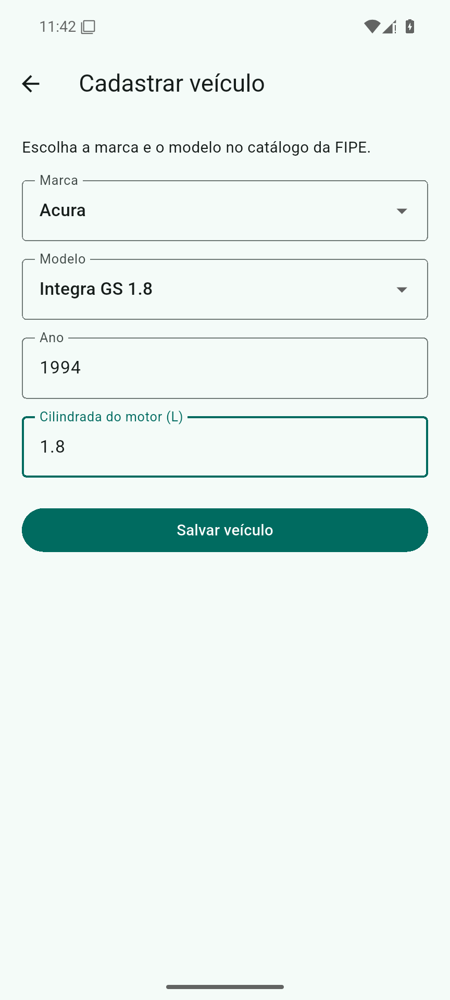
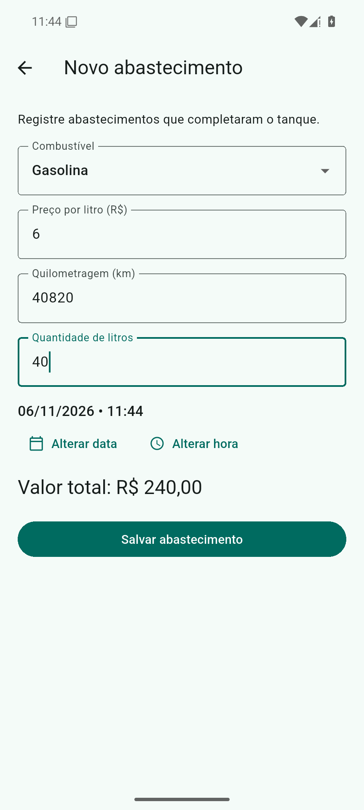
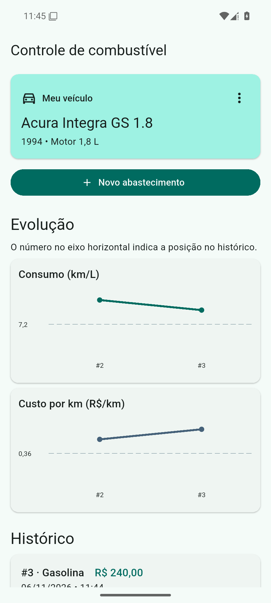
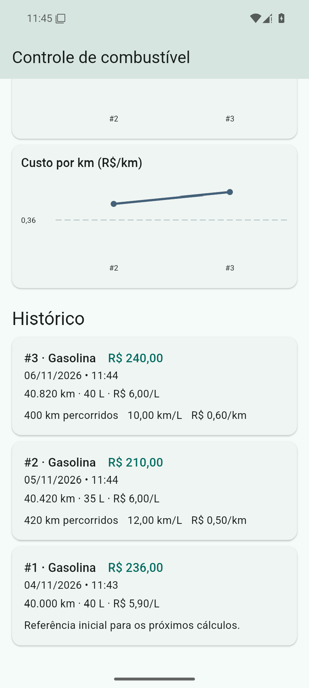

# Controle de combustível

Aplicativo Flutter para Android que registra os abastecimentos de um veículo e mostra o valor de cada registro, o consumo em km/L e o custo por quilômetro em R$/km. O cadastro consulta marcas e modelos da FIPE. O veículo e o histórico ficam salvos no aparelho.

## Executar no Android

1. Instale o [Flutter SDK](https://docs.flutter.dev/install/archive) e configure o SDK do Android pelo Android Studio. O projeto foi preparado com Flutter 3.41.9, Android SDK 36 e JDK 21.
2. Abra a pasta que contém `pubspec.yaml` e conecte um celular com depuração USB ou inicie um emulador Android.
3. Execute os comandos abaixo.

```sh
flutter doctor
flutter pub get
flutter run
```

Se `flutter doctor -v` indicar que o Flutter está usando um JDK incompatível com o Gradle, aponte o Flutter para o JDK 21 com `flutter config --jdk-dir="CAMINHO_DO_JDK_21"`.

Para gerar um APK local, execute `flutter build apk --release`. O arquivo fica em `build/app/outputs/flutter-apk/app-release.apk`. A configuração de assinatura do projeto é a padrão de desenvolvimento do Flutter, adequada para instalação de teste.

## Uso

- Cadastre marca, modelo, ano e cilindrada em litros. A seleção de marca determina os modelos exibidos. Essa consulta precisa de internet.
- Registre o combustível, o preço por litro, a quilometragem inteira, os litros e a data e hora. O app assume que todos os abastecimentos completam o tanque.
- Consulte os valores no histórico e os gráficos de consumo e custo. O primeiro abastecimento é a referência inicial. A partir do segundo, o cálculo usa a diferença de quilometragem em relação ao anterior.
- Para cadastrar outro veículo, abra o menu de três pontos do veículo e confirme a exclusão. O histórico associado também é removido do aparelho.

## API e bibliotecas

| Recurso | Uso |
| --- | --- |
| [FIPE API v2 da Parallelum](https://fipe.api.br/docs/api/fipe) | `GET /api/v2/cars/brands` para marcas e `GET /api/v2/cars/brands/{codigo}/models` para os modelos da marca. |
| [`http`](https://pub.dev/packages/http) | Requisições HTTP à FIPE. |
| [`shared_preferences`](https://pub.dev/packages/shared_preferences) | Persistência local do veículo e de seus abastecimentos em JSON. |
| [`fl_chart`](https://pub.dev/packages/fl_chart) | Gráficos de linha para km/L e R$/km. |
| [`intl`](https://pub.dev/packages/intl) e `flutter_localizations` | Formatação de moeda, números, data e hora e tradução dos seletores do Flutter. |

## Capturas de tela

| Cadastro pela FIPE | Registro de abastecimento |
| --- | --- |
|  |  |

| Gráficos de consumo e custo | Histórico de abastecimentos |
| --- | --- |
|  |  |
